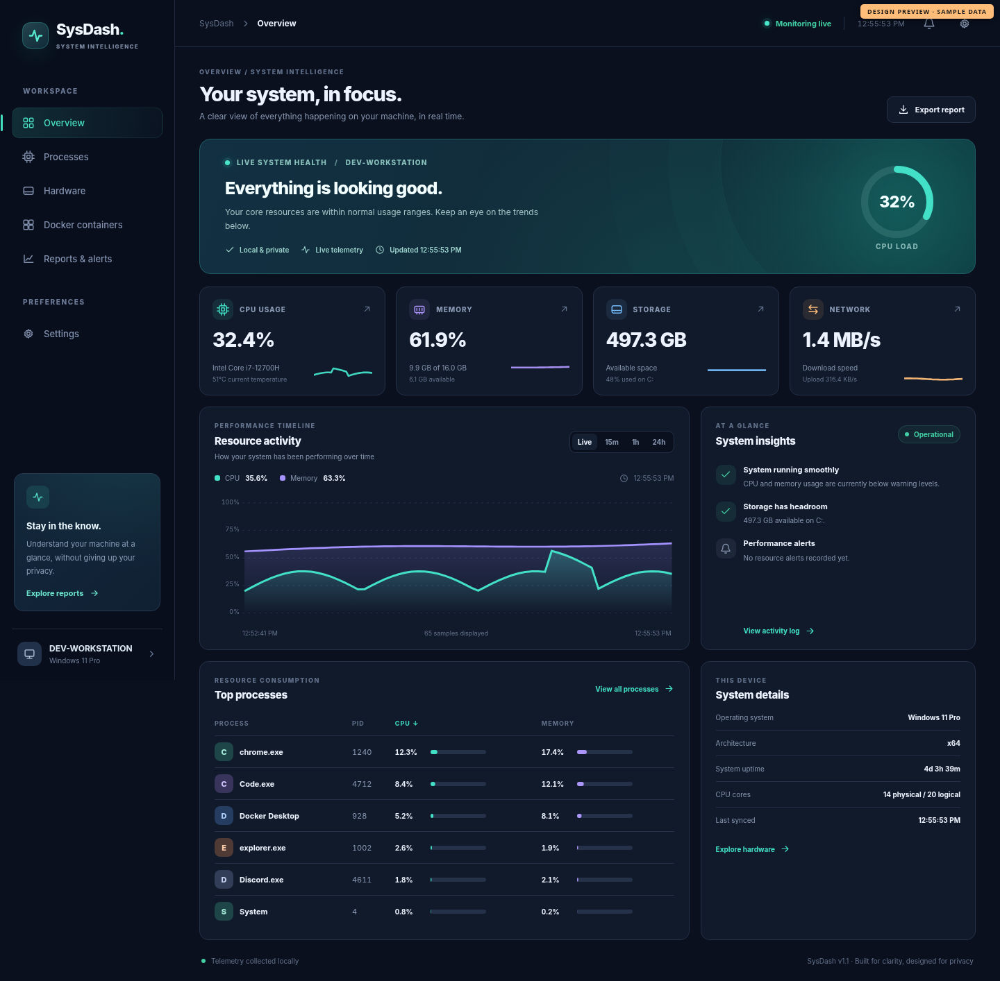

# SysDash — System Intelligence Dashboard

**An Electron + React desktop monitor for real-time performance, local observability and system diagnostics.**

SysDash combines system metrics with a carefully isolated Electron UI. It shows how an operating system is performing without uploading measurements to an external service.



> **v1.1 dashboard development upgrade:** The image uses sample data for presentation. Running SysDash in Electron displays real measurements from your machine. Not all hardware supports temperatures, GPU load or battery statistics, so unsupported readings are shown as unavailable.

## What SysDash can do

- **Live system overview:** overall/per-core CPU, active RAM, swap, available disk space, network transfer rates and disk I/O where available.
- **Interactive performance history:** hoverable CPU and RAM timelines with live, 15-minute, 1-hour and 24-hour selections. Detailed recent samples are held in memory and one representative sample per minute is saved locally for up to 24 hours.
- **Process explorer:** sortable CPU/memory/PID/name columns with name/PID search across the full process list. Only process names, PIDs and resource percentages are exposed to React.
- **Customisable performance alerts:** set sustained CPU, memory or disk thresholds, receive native notifications where supported, and browse the on-device alert log.
- **Hardware page:** filesystem volumes, memory/swap, per-core CPU, network information, supported GPU metrics and optional battery readings.
- **Developer mode:** read-only local Docker container state and resource statistics when Docker is available. No container-control commands.
- **Reports:** export collected metrics to CSV using a native save dialog.
- **Quality-of-life:** dark/light themes, refresh-rate options, optional minimise-to-tray behaviour, secure offline-first architecture and responsive layout.

## Getting started

Requires a supported Node.js LTS release, npm and an operating system supported by Electron and `systeminformation`.

```bash
npm install
npm test
npm run dev      # Electron + Vite development experience
```

For a local production-style launch:

```bash
npm run start    # Builds Vite renderer and starts Electron
```

To create the existing **Windows x64 NSIS installer**:

```bash
npm run dist
```

This script is Windows-specific. On macOS/Linux, use development mode until packaging targets and OS-specific behaviour are validated.

### Applying the v1.1 patch

See [UPGRADE_INSTRUCTIONS.md](UPGRADE_INSTRUCTIONS.md). The patch contains replacement/new source files only. It deliberately does **not** replace your `package.json`, `package-lock.json`, Electron custom protocol module or existing project setup, so existing dependency versions and lockfile remain untouched.

## Screens and navigation

| Screen | Purpose |
| --- | --- |
| Overview | System health, quick performance indicators, interactive history, top processes |
| Processes | Search and sort running processes without exposing sensitive process fields |
| Hardware | CPU cores, RAM/swap, volumes, transfer speeds, supported GPU/battery data |
| Docker containers | Local read-only container statistics, when Docker is running |
| Reports & alerts | Resource history, rule-triggered events, CSV export |
| Settings | Themes, refresh frequency, tray behaviour, alert thresholds |

## Architecture

```text
src/
├─ main/
│  ├─ main.js          Secure Electron lifecycle, narrow IPC, tray, export
│  ├─ channels.js      Named IPC channels
│  ├─ systemInfo.js    Sanitised metric collectors using systeminformation
│  ├─ metricsStore.js  Serial sampler; in-memory + minute-level local history
│  ├─ alerts.js        Sustained thresholds, 5-minute notification cooldown
│  ├─ settings.js      Validated local preferences
│  ├─ protocol.js      Custom myapp:// protocol and CSP (unchanged from v1.0)
│  └─ assets/tray.png  Local tray icon
├─ preload/
│  └─ preload.js       Frozen and explicitly limited window.sysdash API
└─ renderer/
   └─ src/
      ├─ App.jsx       React views, charts, search, settings and interactions
      └─ styles.css    Responsive presentation and themes
```

### Security model

- Electron: `contextIsolation: true`, `nodeIntegration: false`, `sandbox: true`.
- Renderer uses a narrow frozen API defined in the preload. It cannot access arbitrary Node.js or Electron commands.
- IPC handlers validate the frame's origin before responding.
- Settings writes validate known fields and numeric ranges. Report exports use an Electron native save dialog rather than renderer-supplied paths.
- Docker integration reads only the local daemon's statistics.
- The existing `myapp://` handler sends a strict production Content Security Policy. All dashboard styling is in a CSS file rather than React inline style attributes.
- No telemetry, accounts, cloud or external network service are required for core monitoring.

## Operational details & limitations

- The first network/disk I/O reading may be unavailable while `systeminformation` establishes a baseline.
- GPU load, battery and temperature availability differs by OS, GPU driver and permissions.
- 24-hour history represents minutes while SysDash has been running; it **does not** reconstruct periods when the app was closed. Disk persistence is local in Electron's per-user app data directory.
- Docker requires a local running Docker daemon accessible to the current user; no direct container actions are implemented.
- The process explorer returns at most 200 sanitized matching records per request, while reporting the total match count.
- Alerts are informational heuristics, not proof that hardware is faulty.
- The v1.1 source has been syntax-checked and its pure backend modules smoke-tested. The full Jest suite, packaged Electron builds and device-specific hardware collectors must still be exercised in your own development environment.

## Next additions

1. Full desktop regression testing on Windows and macOS, CI packaging fixes, installer signing.
2. Movable/reorderable dashboard widgets and named layout presets.
3. Deeper diagnostics correlating process spikes, disk latency, network saturation and alert windows.
4. Hardware-aware stress testing, optional longer-term archival history, accessibility audits.

**Portfolio idea:** Document the secure IPC contract, time-series sampling choices, and real-world issues caught during cross-platform testing. Those engineering decisions tell a stronger story than a feature checklist alone.
